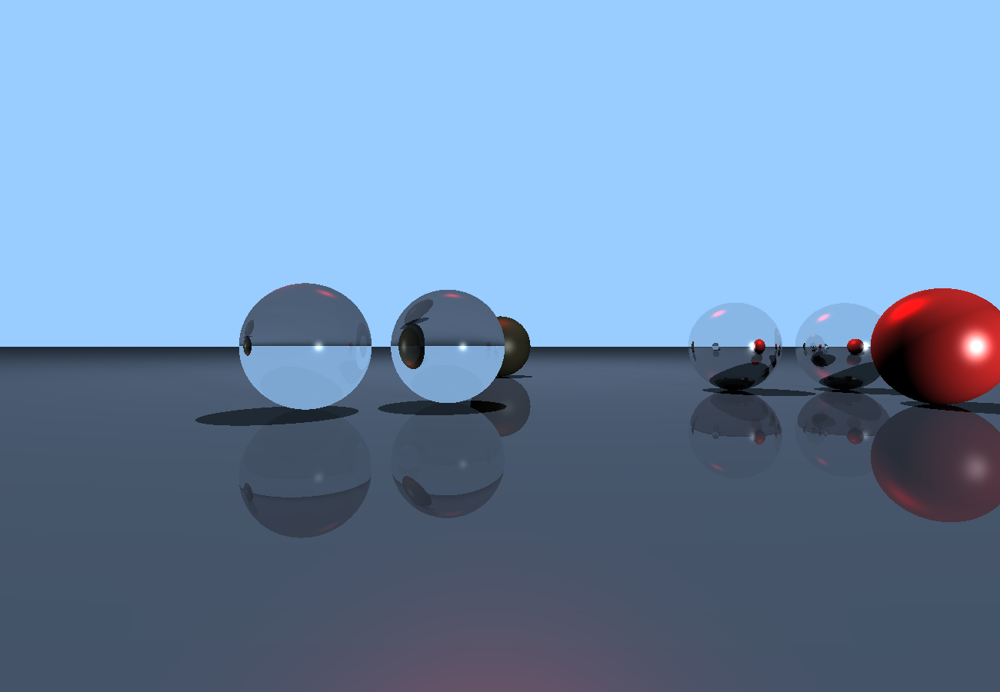
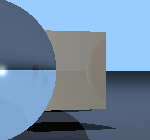
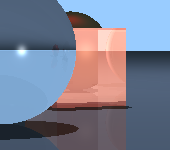
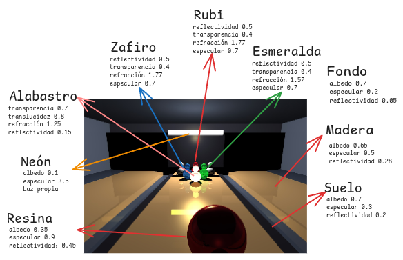

# Raytracing Scenario — Pista de Bolos


[](https://youtu.be/oQEJ_QJpeAo)

**Raytracing por CPU** desarrollado en **Zig 0.16.0**. El escenario modela una pista de bolos tridimensional con pistas de madera, bolas reflectivas, pinos de materiales como alabastro traslúcido, esmeralda, zafiro, rubí y esmalte cerámico.

---

## Video 

**[video](https://youtu.be/oQEJ_QJpeAo)**

---

## Renderizado

### Escena (`resultado.png`)


### Pruebas 
| Cubo opaco y sombras (`crop_cube.png`) | Cubo traslúcido / refractivo (`crop_cube2.png`) |
| :---: | :---: |
|  |  |

### Capturas de desarrollo 
<p align="center">
  
  
</p>

---

## Características

A continuación se listan únicamente los criterios implementados en el código:

| Característica | Archivo |
| :--- | :--- |
| **Rotación en el diorama** | [`src/main.zig`](src/main.zig) |
| **Cámara con acercar y alejar (zoom in/out)** | [`src/main.zig`](src/main.zig)|
| **Múltiples materiales diferenciados** | [`src/materiales/presets.zig`](src/materiales/presets.zig) |
| **Refracción en materiales** | [`src/main.zig`](src/main.zig)|
| **Reflexión en materiales** | [`src/main.zig`](src/main.zig)|
| **Sombras** | [`src/main.zig`](src/main.zig)|
| **Concurrencia** | [`src/main.zig`](src/main.zig)|
| **Material traslúcido (alabastro)** | [`src/main.zig`](src/main.zig)|
| **Forma no vista en clase (caja)** | [`src/objetos/cube.zig`](src/objetos/cube.zig)|
| **Tipo de fuente de luz no visto en clase** | [`src/raytracer.zig`](src/raytracer.zig)|
| **Materiales translúcidos o reflectivos con color** | [`src/main.zig`](src/main.zig)|
| **Materiales que brillan (emisivos)** | [`src/main.zig`](src/main.zig)|

---

## Materiales

Definidos en [`src/materiales/presets.zig`](src/materiales/presets.zig) y posicionados en [`src/objetos/escena.zig`](src/objetos/escena.zig):

| Material | Objeto | Albedo | Especular | Reflectividad | Transparencia | IOR |
| :--- | :---: | :---: | :---: | :---: | :---: | :---: |
| `pista_madera` | `Cube` | `0.65` | `0.5`| `0.28` | `0.0` | `0.0` |
| `suelo` | `Plane` | `0.70` | `0.3`| `0.20` | `0.0` | `0.0` |
| `canaleta` | `Cube` | `0.70` | `0.2`| `0.05` | `0.0` | `0.0` |
| `pared_bolera` | `Cube` | `0.80` | `0.1`| `0.05` | `0.0` | `0.0` |
| `neon_bolera` | `Cube` | `0.10` | `0.0`| `0.00` | `0.0` | `0.0` |
| `bola_bolos` | `Sphere` | `0.35` | `0.9`| `0.45` | `0.0` | `0.0` |
| `espejo` | `Sphere` | `0.00` | `1.0`| `0.90` | `0.0` | `0.0` |
| `alabastro` | `Sphere` | `0.10` | `0.8`| `0.15` | `0.7` | `1.25` |
| `esmeralda` | `Sphere` | `0.15` | `0.7`| `0.50` | `0.4` | `1.57` |
| `zafiro` | `Sphere` | `0.15` | `0.7`| `0.50` | `0.4` | `1.77` |
| `rubi` | `Sphere` | `0.15` | `0.7`| `0.50` | `0.4` | `1.77` |
| `pino_blanco` | `Sphere` | `0.75` | `0.6`| `0.20` | `0.0` | `0.0` |

### Escena (`resultado.png`)


---

## Compilación y ejecución

### Requisitos
* **Zig** `0.16.0`

### Ejecucion
```bash
zig build run -Doptimize=ReleaseFast
```
---

## Referencias
* [Scratchapixel — Introduction to Ray Tracing](https://www.scratchapixel.com/lessons/3d-basic-rendering/introduction-to-ray-tracing/ray-tracing-practical-example.html)
* [Scratchapixel — Framing the LookAt Function](https://www.scratchapixel.com/lessons/mathematics-physics-for-computer-graphics/lookat-function/framing-lookat-function.html)
* [Instructables — Raytracing With Landscapes](https://www.instructables.com/Raytracing-With-Landscapes/)
* [Parallel Programming in Zig: Threads & Shared Memory](https://dev.to/11110110011/parallel-programming-in-zig-threads-shared-memory-and-synchronization-2k21)
